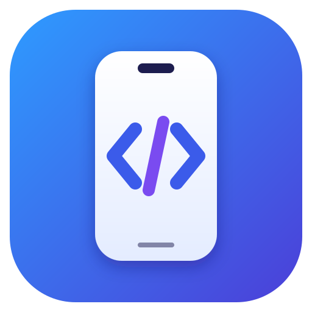

<p align="center"></p>

<h1 align="center">LCode</h1>

**An Xcode-like IDE for Linux, for building iOS apps in Swift and SwiftUI without a Mac.**

LCode is a native GTK4 / libadwaita desktop app. It lets you write a SwiftUI app, run it in a
built-in iPhone simulator, and build, sign and install it on a real iPhone, all from Linux.

> LCode is an independent project. It is not affiliated with or endorsed by Apple. Xcode, iPhone,
> SwiftUI and SF Symbols are trademarks of Apple Inc.

## How it works

Apple's iOS simulator only runs on macOS, so LCode takes a different approach:

- **Simulator: your code is recompiled for Linux.** The same sources are built a second time
  against **LSim**, a reimplementation of the SwiftUI API (plus Combine, AVFoundation, AVKit,
  CoreMedia and CoreVideo). The result is drawn with Cairo/Pango in a window shaped like an
  iPhone. LCode does not emulate iOS. It reproduces SwiftUI's behavior: the layout system, Dynamic Type,
  system colors, navigation, sheets, Liquid Glass, animations and gestures.
- **Device builds go through [xtool](https://github.com/xtool-org/xtool).** The iOS SDK comes from
  an `Xcode.xip` that you download yourself. xtool compiles, signs and installs the app on your
  iPhone over USB or Wi-Fi.
- **Fidelity is measured, not guessed.** A calibration app runs on a real iPhone, measures frames,
  layers, colors and animation curves, and sends them to the PC. The tools then tune a JSON
  design profile so that LSim matches the device, usually within 2 points.

See [ARCHITECTURE.md](ARCHITECTURE.md) for the details.

## Features

- **IDE**: project navigator, Swift editor (GtkSourceView) with sourcekit-lsp completion,
  live `#Preview` canvas, build console, asset catalog editor, Swift Package dependencies,
  Apple account, Signing & Capabilities, and device management.
- **Simulator**: embedded in the IDE window or standalone. iPhone 17 Pro Max, iPhone 16 Pro and
  iPhone SE profiles, light and dark mode, touch emulated with the mouse, keyboard input. Real
  audio and video playback through ffmpeg.
- **SwiftUI coverage**: stacks, grids, `List`, `Form`, `NavigationStack`, `TabView`, sheets,
  alerts, toolbars, the common controls (`Toggle`, `Slider`, `Picker`, `DatePicker`, `TextField`…),
  `@State`, `@Observable`, `@Bindable`, `ObservableObject`, `@AppStorage`, `.task`, asset catalog
  images and colors, SF Symbols, and SwiftPM packages that import SwiftUI.
- **Interface languages**: the IDE follows the system language. English and French are available.

## Install

On Ubuntu, Debian or a derivative (Linux Mint, Pop!_OS…), one command installs everything:

```bash
curl -fsSL https://raw.githubusercontent.com/getlinuxcode/LCode/master/install.sh | bash
```

It installs the system packages (asks for `sudo`) and Swift through swiftly if needed. It then builds LCode in
`~/.local/share/lcode/src`, adds the `lcode` and `lcode-ide` commands to `~/.local/bin`, and creates an
LCode entry in the applications menu. Run it again to update. On other distributions, install the
packages below yourself and run it with `LCODE_NO_APT=1`.

## Requirements

- Linux x86_64 or arm64. LCode is developed on Linux Mint 22 (Ubuntu 24.04 base). Windows support is planned.
- Swift 6.x, installed with [swiftly](https://www.swift.org/install/linux/). On Mint, use
  `swiftly init --platform ubuntu24.04`.
- System libraries:

  ```bash
  sudo apt install libgtk-4-dev libadwaita-1-dev libgtksourceview-5-dev ffmpeg pulseaudio-utils
  ```

- Optional, for real devices: [xtool](https://github.com/xtool-org/xtool) with an iOS SDK
  extracted from Xcode, and an Apple ID.
- Optional, for exact typography: Apple's SF Pro fonts installed locally in
  `~/.local/share/fonts`. LCode never ships them. Without them, a free fallback font is used.

## Usage

### IDE

```bash
lcode-ide              # welcome window
lcode open MyApp       # open a project
```

### Command line

```bash
lcode new MyApp --in ~/Projects               # create an iOS app project (xtool)
lcode run ~/Projects/MyApp                    # run it in the simulator
lcode run ~/Projects/MyApp --dark --device-model iphonese
lcode run ~/Projects/MyApp --device           # build, sign and install on the iPhone
lcode preview ~/Projects/MyApp --index 1      # render a #Preview
lcode run ~/Projects/MyApp --capture shot.png --wait 2   # headless screenshot
```

Run `lcode --help` for every option.

### Examples

`Examples/` contains small SwiftUI apps (Counter, Fruits, the Catalog used for calibration, and
`Sonde`, an API-coverage probe):

```bash
lcode run ~/.local/share/lcode/src/Examples/iOS/Fruits
```

## Development

```bash
git clone https://github.com/getlinuxcode/LCode.git
cd LCode
swift build
swift run lcode-ide                 # the IDE
.build/debug/lcode run Examples/iOS/Fruits
swift test
```

`LCODE_LANGUAGE=en` (or `fr`) forces the IDE's language.

## Calibration

The calibration tools need a real iPhone and are only useful to people working on LSim's
fidelity:

```bash
python3 -I tools/calibration/calibrate.py
```

This builds and installs the calibration catalog on the iPhone, receives the measurements, fits
`Sources/LSimUI/Profiles/iOS-27.2.json`, and checks for regressions. See
[ARCHITECTURE.md](ARCHITECTURE.md#calibration-bench).

## Limitations

- UIKit, hardware frameworks and closed frameworks (ARKit, camera, HealthKit…) are stubs or
  are missing in the simulator.
- The simulator validates UI and logic, not real performance. Final testing happens on a device.
- Only iPhone profiles exist so far. iPad, Mac and Apple TV are on the roadmap.

## Contributing

Issues and pull requests are welcome. To translate the IDE into a new language, add
`Sources/LCodeKit/Localization/Translations+<code>.swift` (keys are the English strings) and
register it in `Translations.swift`.

## License

LCode is released under the [MIT License](LICENSE).
